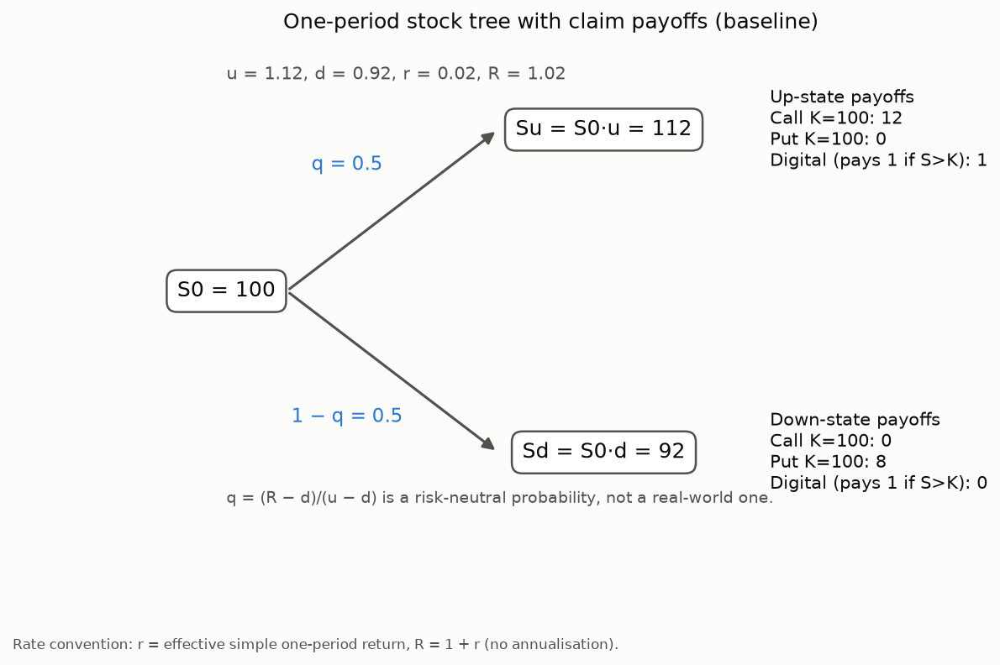
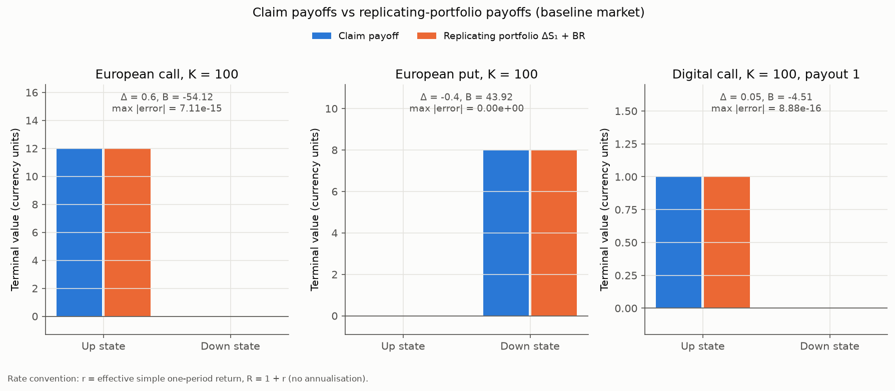
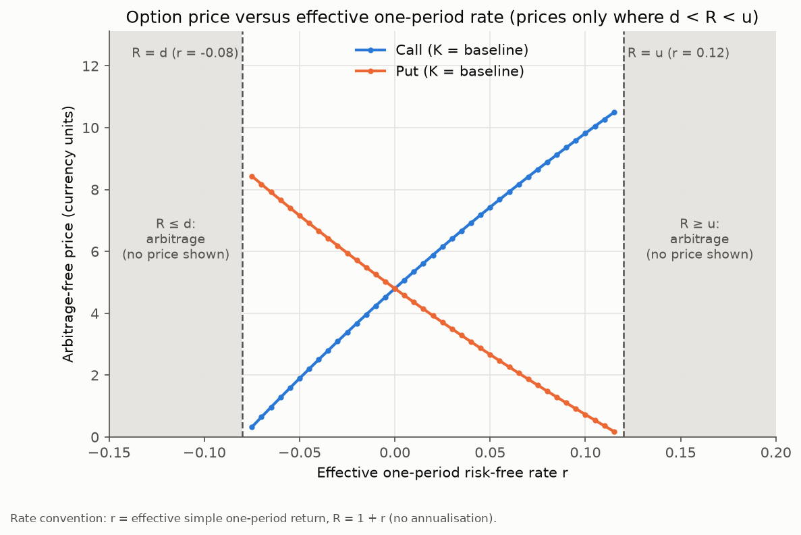
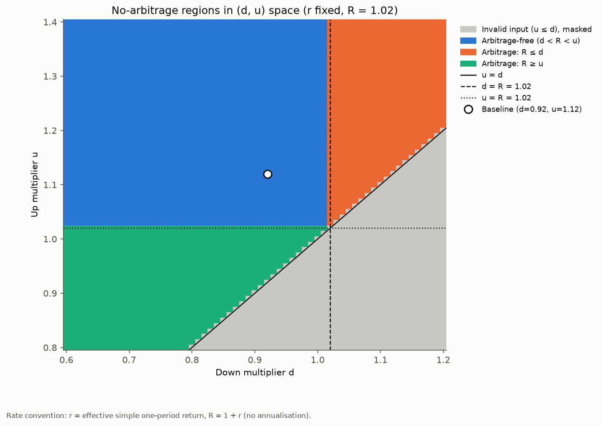

# One-Period Binomial Model and Arbitrage Detection

**Status:** a complete educational project. It runs locally and is reproducible. Every number, table and chart below comes from executing the code in this folder. It is a teaching tool, not production trading software, and it uses no market data.

The project implements Project 1, *One-Period Binomial Model and Arbitrage Detection*, from the *Basic Quantitative Finance Projects* guide. Where the guide's statements were inconsistent, this project fixes them and records each change in [docs/reference_corrections.md](docs/reference_corrections.md). AI assistance was used to develop it.

## Purpose and features

A one-period, two-state market with one stock and one risk-free cash account, used to show:

1. **No-arbitrage classification** (strict `d < R < u`). Each market is labelled arbitrage-free, R ≤ d, R ≥ u, near-boundary unresolved or invalid input. The classification uses exact arithmetic.
2. **Risk-neutral valuation**, done only where the market is arbitrage-free. The risk-neutral weight `q` is never clipped.
3. **State prices** and their identities: they sum to `1/R`, and they reprice the stock.
4. **Exact replication** with stock and cash, verified independently in both states, with a `numpy.linalg.solve` cross-check.
5. **Explicit stock/cash arbitrage portfolios** when the market is invalid, including the exact equality cases `R = d` and `R = u`.
6. **Quote arbitrage.** When a claim's quote differs from its replication cost, every leg of the arbitrage portfolio is listed and checked.
7. **Sensitivity analysis:** strike sweep, rate sweep, and a (u, d) grid with invalid regions masked.
8. **Clear numerical boundary handling:** conditioning checks and documented tolerances.

Claims covered: European call, European put, cash-or-nothing digital call (pays only if `S_T > K`, strictly), and generic two-state payoffs, which may be negative.

**Rate convention:** `r` is the effective simple risk-free return over the single period, and `R = 1 + r`. There is no annualisation and no `exp(r)`.

## Installation

Python 3.11 or later is required. The project was tested with Python 3.14.4.

### Windows (PowerShell)

```powershell
py -3 -m venv .venv
.\.venv\Scripts\Activate.ps1
python -m pip install -e ".[dev]"
```

### macOS / Linux

```bash
python3 -m venv .venv
source .venv/bin/activate
python -m pip install -e ".[dev]"
```

To reproduce the exact tested versions, run `python -m pip install -r requirements-lock.txt` before the editable install.

## Quick start (from the project root)

```bash
python scripts/price_claim.py --config configs/baseline.json --claim call
```

```bash
python scripts/price_claim.py --config configs/baseline.json --claim put
```

```bash
python scripts/price_claim.py --config configs/baseline.json --claim digital
```

```bash
python scripts/analyze_market.py --config configs/baseline.json
```

```bash
python scripts/run_experiments.py --config configs/scenarios.json
```

```bash
python -m pytest -q --junitxml=results/baseline/test_results.xml
```

```bash
python scripts/generate_report.py --results-dir results/baseline
```

Each script has `--help`. Paths may contain spaces. Outputs are overwritten on every run, never appended.

## Actual example output

`price_claim.py --claim call` on the baseline market (`S0 = 100, u = 1.12, d = 0.92, r = 0.02, K = 100`) prints a JSON record. Its key fields were:

```
classification.status          arbitrage_free
pricing.risk_neutral_q         0.5
pricing.arbitrage_free_price   5.88235294117647
replication.delta              0.6
replication.cash_B             -54.11764705882353
replication.max_abs_error      7.105427357601e-15
```

`run_experiments.py --config configs/scenarios.json` printed:

```
Scenarios: 25 (2 rejected as invalid input, as expected)
Scenarios by status: {'arbitrage_R_ge_u': 3, 'arbitrage_R_le_d': 2, 'arbitrage_free': 16, 'invalid_input': 2, 'near_boundary_unresolved': 2}
Replication checks passed: 23/23
Max abs replication error: 1.599e-14
Verified stock/cash arbitrage portfolios: 5/5 arbitrage markets (+1 candidate in a near-boundary unresolved market)
Verified quote arbitrage portfolios: 3/5 quote scenarios
Warnings: 3; failures: 0
Outputs written: 18 files
```

Of the five quote scenarios, two are correctly not arbitrage: one quote matches the replication cost within tolerance, and the other sits in a market that already contains stock/cash arbitrage, so it is not assessed.

## Baseline results

| Claim | Payoffs (up, down) | Arbitrage-free price | Replication Δ | Replication B (time 0) |
|---|---|---|---|---|
| European call | (12, 0) | 5.8823529412 | 0.6 | −54.11764706 |
| European put | (0, 8) | 3.9215686275 | −0.4 | 43.92156863 |
| Digital call (payout 1) | (1, 0) | 0.4901960784 | 0.05 | −4.509803922 |

The baseline values are `q = 0.5`, `R = 1.02`, and state prices `π_up = π_down = 0.4901960784`. The put–call parity residual is −7.6e-15.

The guide states the baseline call price as about 8.43. That figure is not reproducible under either rate convention; see [docs/reference_corrections.md](docs/reference_corrections.md).

## Scenario summary (selected rows from `results/baseline/scenario_summary.csv`)

| Scenario | Status | q (unclipped) | Arbitrage-free price | Notes |
|---|---|---|---|---|
| deep_itm_call (K = 80) | arbitrage_free | 0.5 | 21.568627 | exactly `S0 − K/R` |
| zero_strike_call | arbitrage_free | 0.5 | 100.000000 | equals `S0` |
| negative_rate_no_arbitrage | arbitrage_free | 0.466667 | 2.405498 | r = −0.03 |
| both_multipliers_above_one | arbitrage_free | 0.285714 | 2.721088 | u = 1.15, d = 1.01 |
| both_multipliers_below_one | arbitrage_free | 0.714286 | 6.766917 | u = 0.99, d = 0.85 |
| r_below_d | arbitrage_R_le_d | −0.15 | — | arbitrage verified: payoffs (23, 3) |
| r_above_u | arbitrage_R_ge_u | 1.714286 | — | arbitrage verified: payoffs (5, 12) |
| r_equal_d_exact | arbitrage_R_le_d | 0 | — | arbitrage verified: payoffs (10, 0) |
| r_equal_u_exact | arbitrage_R_ge_u | 1 | — | arbitrage verified: payoffs (0, 20) |
| near_boundary_inside | near_boundary_unresolved | 1e-11 | — | not priced, not called arbitrage |
| degenerate_u_equals_d | invalid_input | — | — | rejected |
| quote_overpriced_call (M = 6.50) | arbitrage_free | 0.5 | 5.882353 | profit 0.63 in both states |
| quote_underpriced_call (M = 5.20) | arbitrage_free | 0.5 | 5.882353 | profit 0.696 in both states |

The full tables are in [results/baseline/research_report.md](results/baseline/research_report.md).

## Selected figures









The other charts are in `results/baseline/figures/`: call and put price versus strike, replication hedge ratio versus strike, and the call-price heatmap.

## Folder structure

```
One-Period Binomial Model and Arbitrage Detection/
├── README.md, pyproject.toml, requirements-lock.txt, LICENSE
├── configs/            baseline.json, scenarios.json
├── src/binomial_arbitrage/
│   ├── validation.py   inputs, exact Decimal conversion, tolerance policy
│   ├── model.py        MarketParams, no-arbitrage classification
│   ├── payoffs.py      call, put, digital, generic payoffs
│   ├── pricing.py      risk-neutral price, state prices
│   ├── replication.py  Δ, B, independent verification
│   ├── arbitrage.py    stock/cash and quote arbitrage portfolios
│   ├── sensitivity.py  strike, rate and (u, d) sweeps
│   ├── plotting.py     static Matplotlib charts
│   └── reporting.py    experiment runner, writers, metadata, report
├── scripts/            price_claim.py, analyze_market.py, run_experiments.py, generate_report.py
├── tests/              conftest.py + 7 test modules
├── docs/               methodology, results, validation, reference_corrections, learning_guide, references
└── results/            README.md, baseline/ (CSV, JSON, XML, report, figures/)
```

## Testing

```bash
python -m pytest -q
```

Final recorded run (`results/baseline/test_results.xml`): **222 tests collected, 222 passed, 0 failed, 0 skipped.** No coverage percentage was measured, so none is claimed. [docs/validation.md](docs/validation.md) explains what the tests check independently.

## Assumptions and limitations

- One period, two states, and both states possible. Frictionless markets: no costs, no spreads, unrestricted short selling, one borrowing and lending rate, fractional positions, no dividends.
- Out of scope: multi-period trees, American exercise, GBM, Black–Scholes, Monte Carlo, implied volatility, transaction costs, dividends, calibration to real markets, and any trading integration.
- The replication hedge ratio is a static one-period payoff-matching coefficient. It is not a spot-price derivative, and no gamma is reported.
- Quote-arbitrage results are model statements. They don't show that a real quote can be traded.
- Inputs are interpreted as exact decimals. Markets within the stated relative tolerance of a boundary are reported as unresolved.

## Documentation

- [docs/methodology.md](docs/methodology.md): model, formulas, tolerance and conditioning policy
- [docs/results.md](docs/results.md): actual outputs and findings
- [docs/validation.md](docs/validation.md): test counts, independent checks, tolerances
- [docs/reference_corrections.md](docs/reference_corrections.md): discrepancies found in the guide's Project 1
- [docs/learning_guide.md](docs/learning_guide.md): plain-language explanations and self-check questions
- [docs/references.md](docs/references.md): sources
- [results/README.md](results/README.md): output definitions, units and how the outputs are generated

## Licence

MIT. See [LICENSE](LICENSE). Copyright (c) 2026 Amogh.