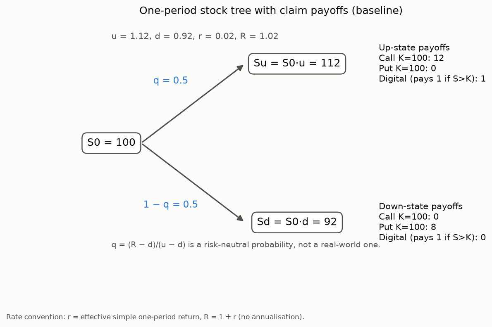
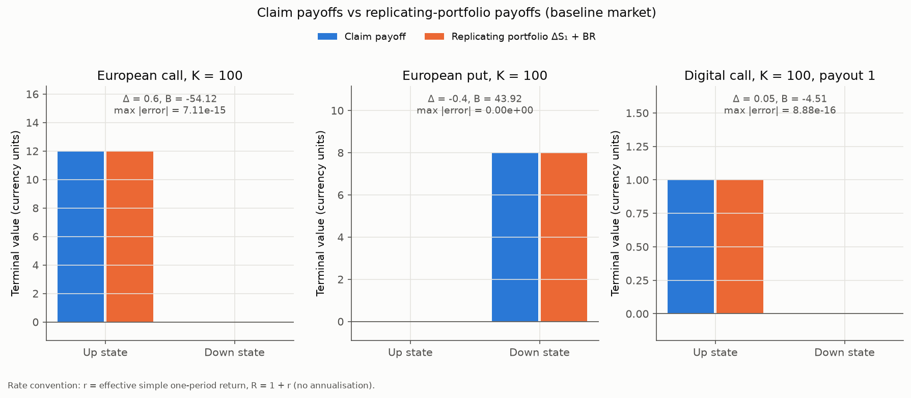
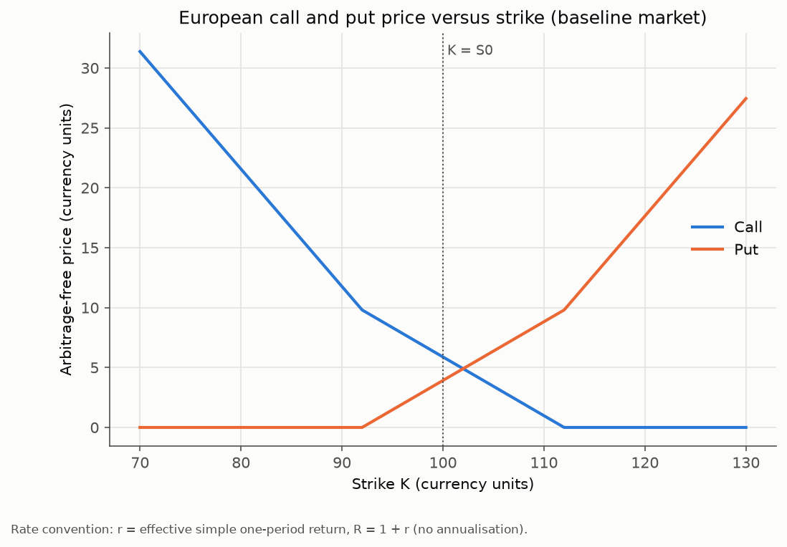
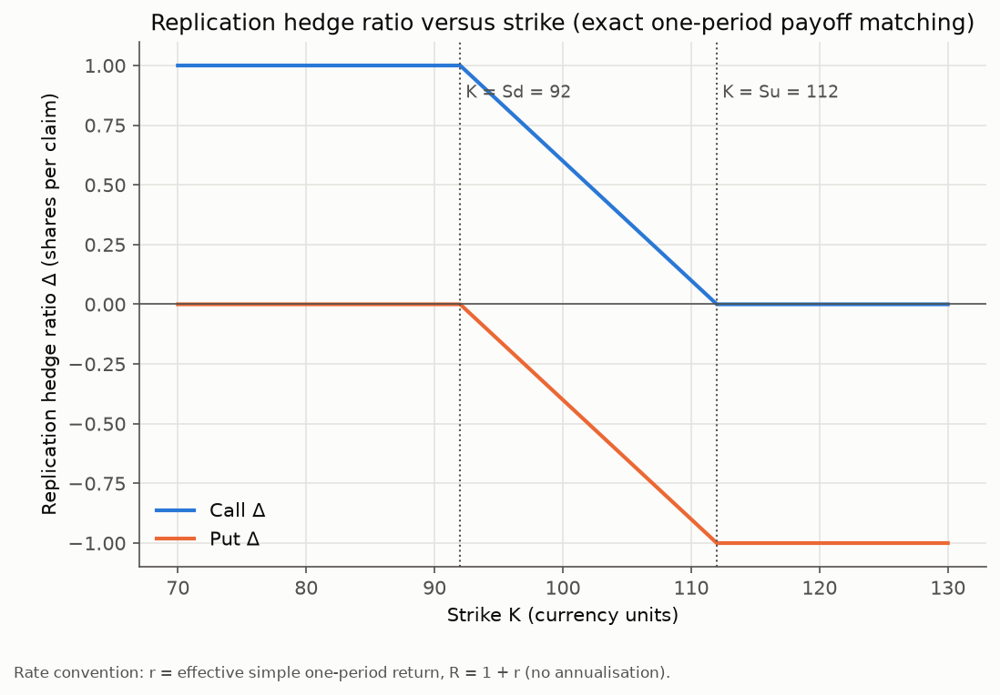
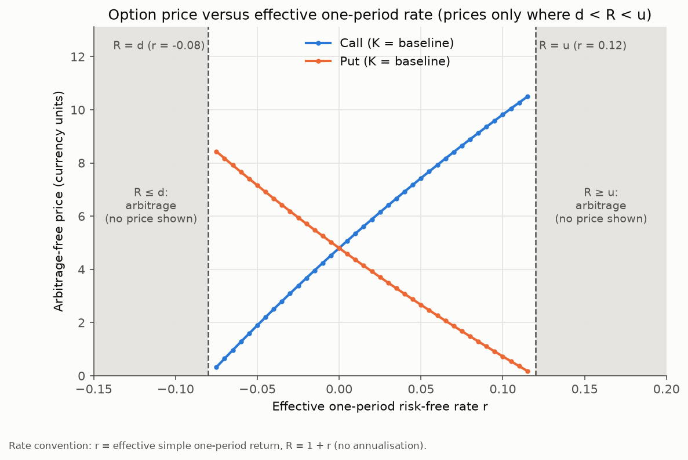
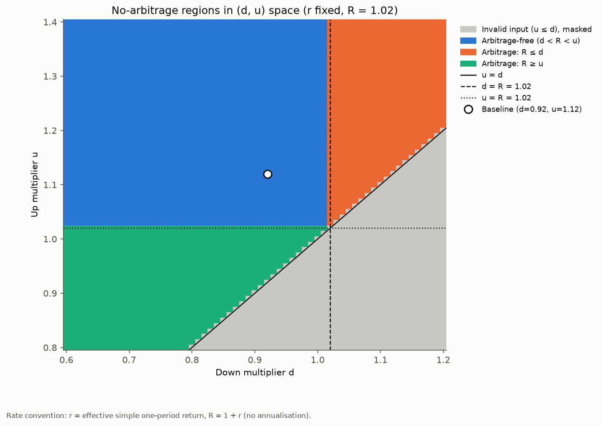
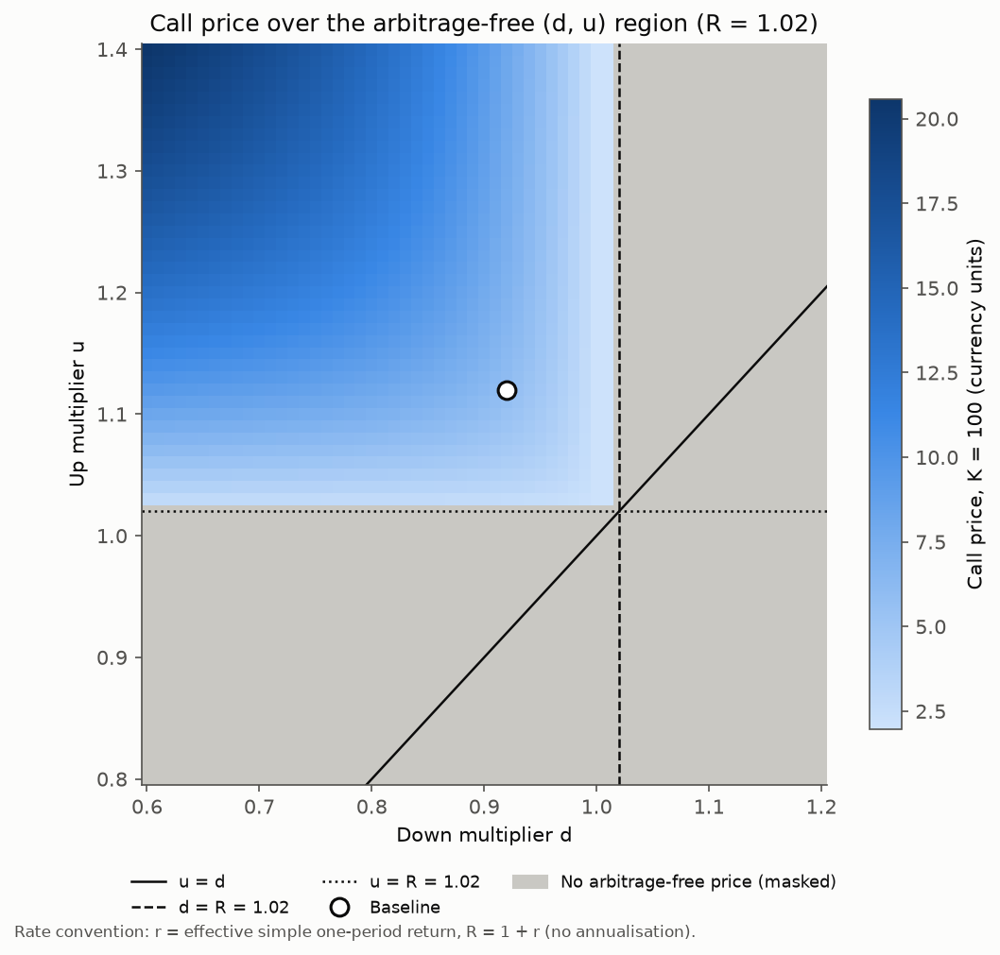

# Research Report: One-Period Binomial Model and Arbitrage Detection

*Generated by `scripts/generate_report.py` from the saved files in this folder. Experiment run (UTC): 2026-11-15T13:20:27Z; Python 3.14.4; numpy 2.5.4, pandas 3.1.1, matplotlib 3.11.2, pytest 9.2.0.*

## 1. Overview

This report summarises an educational one-period, two-state market with one stock and one risk-free cash account. It classifies markets by the strict no-arbitrage condition d < R < u, prices claims by risk-neutral valuation and state prices where (and only where) the market is arbitrage-free, verifies exact stock-and-cash replication state by state, constructs explicit arbitrage portfolios for invalid markets and mispriced quotes, and runs strike, rate and (u, d) sensitivity analyses. All numbers below are read from the CSV/JSON files produced by `scripts/run_experiments.py`; nothing is hard-coded.

- Scenarios evaluated: **25** (arbitrage_R_ge_u: 3, arbitrage_R_le_d: 2, arbitrage_free: 16, invalid_input: 2, near_boundary_unresolved: 2).
- Replication checks passed: **23 / 23**; maximum absolute replication error **1.599e-14** currency units.
- Run warnings: 3; run failures: 0.
- Automated tests (from `test_results.xml`): 222 collected, 222 passed, 0 failed, 0 errors, 0 skipped.

## 2. Model configuration

**Rate convention.** r is the effective simple risk-free return over one model period; R = 1 + r; cash B at time 0 grows to B*R; no annualisation; no exp(r). If starting from a continuous annual rate rc and maturity T: R = exp(rc*T), r = R - 1 (documented, not implemented).

| Quantity | Value |
|---|---|
| S0 | 100 |
| u | 1.12 |
| d | 0.92 |
| r | 0.02 |
| R = 1 + r | 1.02 |
| Su = S0·u | 112 |
| Sd = S0·d | 92 |
| Strike K | 100 |
| Digital cash payout | 1 (paid if S_T > K, strict) |
| Market status | arbitrage_free |
| Risk-neutral q = (R − d)/(u − d) | 0.5 |

Tolerances used (units in `docs/methodology.md`): `near_boundary_relative_gap` = 1e-10, `min_relative_state_separation` = 1e-12, `narrow_relative_state_separation` = 1e-06, `payoff_abs_tol` = 1e-09, `quote_abs_tol` = 1e-09, `quote_rel_tol` = 1e-09, `replication_abs_tol` = 1e-09.

## 3. Baseline pricing

| Claim | Payoff up | Payoff down | Arbitrage-free price | Replication Δ (shares) | Replication B (time-0 cash) | Replication cost | Price − cost |
|---|---|---|---|---|---|---|---|
| European call | 12 | 0 | 5.8823529412 | 0.6 | -54.11764706 | 5.8823529412 | -8.882e-16 |
| European put | 0 | 8 | 3.9215686275 | -0.4 | 43.92156863 | 3.9215686275 | 0.000e+00 |
| Cash-or-nothing digital call | 1 | 0 | 0.4901960784 | 0.05 | -4.509803922 | 0.4901960784 | 0.000e+00 |

State prices: π_up = 0.4901960784, π_down = 0.4901960784; π_up + π_down − 1/R = 0.000e+00; π_up·Su + π_down·Sd − S0 = 0.000e+00. State prices are time-0 prices of one unit paid in a state; they sum to 1/R and are not probabilities.

Put–call parity check: C − P − (S0 − K/R) = -7.550e-15.

## 4. Replication checks

Each claim is replicated independently (the put does not reuse call results). Portfolio terminal values are recomputed from Δ and B, and `numpy.linalg.solve` provides a second solution of the 2×2 system.

| scenario_id | claim | market_status | delta | cash_B | initial_cost | error_up | error_down | max_abs_error | linalg_max_abs_diff | check_passed |
|---|---|---|---|---|---|---|---|---|---|---|
| baseline_call | call(K=100) | arbitrage_free | 0.6 | -54.1176 | 5.882353 | 0.00e+00 | -7.11e-15 | 7.11e-15 | 0.00e+00 | True |
| baseline_put | put(K=100) | arbitrage_free | -0.4 | 43.9216 | 3.921569 | 0.00e+00 | 0.00e+00 | 0.00e+00 | 7.11e-15 | True |
| baseline_digital | digital(K=100, payout=1) | arbitrage_free | 0.05 | -4.5098 | 0.490196 | 8.88e-16 | 8.88e-16 | 8.88e-16 | 8.88e-16 | True |
| deep_itm_call | call(K=80) | arbitrage_free | 1 | -78.4314 | 21.568627 | 0.00e+00 | 0.00e+00 | 0.00e+00 | 1.42e-14 | True |
| deep_otm_call | call(K=130) | arbitrage_free | 0 | 0 | 0.000000 | 0.00e+00 | 0.00e+00 | 0.00e+00 | 0.00e+00 | True |
| zero_strike_call | call(K=0) | arbitrage_free | 1 | 0 | 100.000000 | 0.00e+00 | 0.00e+00 | 0.00e+00 | 0.00e+00 | True |
| generic_negative_payoff | generic(Xu=-5, Xd=10) | arbitrage_free | -0.75 | 77.451 | 2.450980 | 0.00e+00 | 0.00e+00 | 0.00e+00 | 1.42e-14 | True |
| negative_rate_no_arbitrage | call(K=100) | arbitrage_free | 0.333333 | -30.9278 | 2.405498 | 0.00e+00 | 0.00e+00 | 0.00e+00 | 3.20e-14 | True |
| both_multipliers_above_one | call(K=105) | arbitrage_free | 0.714286 | -68.7075 | 2.721088 | 0.00e+00 | 0.00e+00 | 0.00e+00 | 0.00e+00 | True |
| both_multipliers_below_one | call(K=90) | arbitrage_free | 0.642857 | -57.5188 | 6.766917 | 7.11e-15 | 7.11e-15 | 7.11e-15 | 7.11e-14 | True |
| r_below_d | call(K=100) | arbitrage_R_le_d | 1 | -98.0392 | 1.960784 | -1.42e-14 | -1.42e-14 | 1.42e-14 | 1.42e-14 | True |
| r_above_u | call(K=100) | arbitrage_R_ge_u | 0.714286 | -63.6364 | 7.792208 | 0.00e+00 | 0.00e+00 | 0.00e+00 | 7.82e-14 | True |
| r_equal_d_exact | call(K=100) | arbitrage_R_le_d | 1 | -98.0392 | 1.960784 | -1.42e-14 | -1.42e-14 | 1.42e-14 | 1.42e-14 | True |
| r_equal_u_exact | call(K=100) | arbitrage_R_ge_u | 0.6 | -49.2857 | 10.714286 | 0.00e+00 | -7.11e-15 | 7.11e-15 | 1.42e-14 | True |
| near_boundary_inside | call(K=100) | near_boundary_unresolved | 1 | -98.0392 | 1.960784 | -1.42e-14 | -1.60e-14 | 1.60e-14 | 1.56e-13 | True |
| near_boundary_outside | call(K=100) | near_boundary_unresolved | 1 | -98.0392 | 1.960784 | -1.42e-14 | -1.24e-14 | 1.42e-14 | 2.84e-14 | True |
| narrow_valid_separation | call(K=102) | arbitrage_free | 0.5 | -49.9951 | 0.004902 | -1.99e-15 | -7.11e-15 | 7.11e-15 | 1.98e-11 | True |
| narrow_separation_warning | call(K=102) | arbitrage_free | 0.5 | -50 | 0.000025 | 1.66e-15 | 0.00e+00 | 1.66e-15 | 3.06e-09 | True |
| quote_overpriced_call | call(K=100) | arbitrage_free | 0.6 | -54.1176 | 5.882353 | 0.00e+00 | -7.11e-15 | 7.11e-15 | 0.00e+00 | True |
| quote_underpriced_call | call(K=100) | arbitrage_free | 0.6 | -54.1176 | 5.882353 | 0.00e+00 | -7.11e-15 | 7.11e-15 | 0.00e+00 | True |
| quote_matching_call | call(K=100) | arbitrage_free | 0.6 | -54.1176 | 5.882353 | 0.00e+00 | -7.11e-15 | 7.11e-15 | 0.00e+00 | True |
| quote_overpriced_put | put(K=100) | arbitrage_free | -0.4 | 43.9216 | 3.921569 | 0.00e+00 | 0.00e+00 | 0.00e+00 | 7.11e-15 | True |
| quote_in_arbitrage_market | call(K=100) | arbitrage_R_ge_u | 0.714286 | -63.6364 | 7.792208 | 0.00e+00 | 0.00e+00 | 0.00e+00 | 7.82e-14 | True |

For markets that are not arbitrage-free, the `initial_cost` column is an algebraic replication cost, **not** an arbitrage-free valuation.

## 5. Scenario results

| scenario_id | market_status | exact_boundary | q_candidate | claim | arbitrage_free_price | algebraic_cost_NOT_arbitrage_free | warnings | error_message |
|---|---|---|---|---|---|---|---|---|
| baseline_call | arbitrage_free | — | 0.5 | call(K=100) | 5.882353 | — | — | — |
| baseline_put | arbitrage_free | — | 0.5 | put(K=100) | 3.921569 | — | — | — |
| baseline_digital | arbitrage_free | — | 0.5 | digital(K=100, payout=1) | 0.490196 | — | — | — |
| deep_itm_call | arbitrage_free | — | 0.5 | call(K=80) | 21.568627 | — | — | — |
| deep_otm_call | arbitrage_free | — | 0.5 | call(K=130) | 0.000000 | — | — | — |
| zero_strike_call | arbitrage_free | — | 0.5 | call(K=0) | 100.000000 | — | — | — |
| generic_negative_payoff | arbitrage_free | — | 0.5 | generic(Xu=-5, Xd=10) | 2.450980 | — | — | — |
| negative_rate_no_arbitrage | arbitrage_free | — | 0.466667 | call(K=100) | 2.405498 | — | — | — |
| both_multipliers_above_one | arbitrage_free | — | 0.285714 | call(K=105) | 2.721088 | — | — | — |
| both_multipliers_below_one | arbitrage_free | — | 0.714286 | call(K=90) | 6.766917 | — | — | — |
| r_below_d | arbitrage_R_le_d | — | -0.15 | call(K=100) | — | 1.960784 | — | — |
| r_above_u | arbitrage_R_ge_u | — | 1.71429 | call(K=100) | — | 7.792208 | — | — |
| r_equal_d_exact | arbitrage_R_le_d | R_equals_d | 0 | call(K=100) | — | 1.960784 | — | — |
| r_equal_u_exact | arbitrage_R_ge_u | R_equals_u | 1 | call(K=100) | — | 10.714286 | — | — |
| near_boundary_inside | near_boundary_unresolved | — | 1e-11 | call(K=100) | — | 1.960784 | near_boundary: relative gap 1.000e-11 < tolerance 1.0e-10 (R is mathematically inside the open interval (d, u)) | — |
| near_boundary_outside | near_boundary_unresolved | — | -1e-11 | call(K=100) | — | 1.960784 | near_boundary: relative gap 1.000e-11 < tolerance 1.0e-10 (R is mathematically outside the open interval (d, u)) | — |
| narrow_valid_separation | arbitrage_free | — | 0.5 | call(K=102) | 0.004902 | — | — | — |
| narrow_separation_warning | arbitrage_free | — | 0.5 | call(K=102) | 0.000025 | — | narrow_state_separation: (u - d)/u = 9.804e-07 < 1.0e-06; replication positions can be large relative to payoffs and results are sensitive to input rounding | — |
| ill_conditioned_rejected | invalid_input | — | — | call(K=100) | — | — | — | ill-conditioned state separation: (u - d)/u = 9.804e-14 is below the conditioning limit 1.0e-12; replication would divide by a near-zero denominator |
| degenerate_u_equals_d | invalid_input | — | — | call(K=100) | — | — | — | u == d == 1.05: degenerate single-state market, outside the two-distinct-state scope |
| quote_overpriced_call | arbitrage_free | — | 0.5 | call(K=100) | 5.882353 | — | — | — |
| quote_underpriced_call | arbitrage_free | — | 0.5 | call(K=100) | 5.882353 | — | — | — |
| quote_matching_call | arbitrage_free | — | 0.5 | call(K=100) | 5.882353 | — | — | — |
| quote_overpriced_put | arbitrage_free | — | 0.5 | put(K=100) | 3.921569 | — | — | — |
| quote_in_arbitrage_market | arbitrage_R_ge_u | — | 1.71429 | call(K=100) | — | 7.792208 | — | — |

`q_candidate` is reported without clipping. It is a risk-neutral probability only for `arbitrage_free` rows.

## 6. Arbitrage scenarios

### 6.1 Stock/cash (underlying-market) arbitrage

| scenario_id | market_status | case | stock_shares | cash_account | initial_cost | payoff_up | payoff_down | nonnegative_payoffs | strict_gain_in_some_state | verified |
|---|---|---|---|---|---|---|---|---|---|---|
| r_below_d | arbitrage_R_le_d | A_R_le_d | 1 | -100 | 0 | 23 | 3 | True | True | True |
| r_above_u | arbitrage_R_ge_u | B_R_ge_u | -1 | 100 | 0 | 5 | 12 | True | True | True |
| r_equal_d_exact | arbitrage_R_le_d | A_R_le_d | 1 | -100 | 0 | 10 | 0 | True | True | True |
| r_equal_u_exact | arbitrage_R_ge_u | B_R_ge_u | -1 | 100 | 0 | 0 | 20 | True | True | True |
| near_boundary_outside | near_boundary_unresolved | A_R_le_d | 1 | -100 | 0 | 10 | 1e-10 | True | True | True |
| quote_in_arbitrage_market | arbitrage_R_ge_u | B_R_ge_u | -1 | 100 | 0 | 5 | 12 | True | True | True |

Case A (R ≤ d): buy 1 share, borrow S0. Case B (R ≥ u): short 1 share, deposit S0. Payoffs are computed in exact rational arithmetic, so the equality cases R = d and R = u show an exact zero in one state and a strict gain in the other.

Note: `near_boundary_outside` keeps the status `near_boundary_unresolved` because R is within the stated relative tolerance of a boundary. Taking its decimal inputs as exact, the candidate portfolio's payoffs are still nonnegative with a strict gain, so the portfolio check passes; the *classification* is nevertheless not reported as a confident arbitrage, because it rests on digits far beyond realistic input precision.

### 6.2 Quote arbitrage

| scenario_id | direction | row_type | leg | quantity | time0_cashflow | payoff_up | payoff_down | verified |
|---|---|---|---|---|---|---|---|---|
| quote_overpriced_call | overpriced | leg | short claim | -1 | 6.5 | -12 | 0 | — |
| quote_overpriced_call | overpriced | leg | stock (replicating Delta) | 0.6 | -60 | 67.2 | 55.2 | — |
| quote_overpriced_call | overpriced | leg | cash account (replicating B) | -54.1176 | 54.1176 | -55.2 | -55.2 | — |
| quote_overpriced_call | overpriced | leg | invest surplus abs(M - V) in cash account | 0.617647 | -0.617647 | 0.63 | 0.63 | — |
| quote_overpriced_call | overpriced | net | NET (initial cost = -sum of time-0 cashflows) | — | 0 | 0.63 | 0.63 | True |
| quote_underpriced_call | underpriced | leg | long claim | 1 | -5.2 | 12 | 0 | — |
| quote_underpriced_call | underpriced | leg | stock (short replicating Delta) | -0.6 | 60 | -67.2 | -55.2 | — |
| quote_underpriced_call | underpriced | leg | cash account (short replicating B) | 54.1176 | -54.1176 | 55.2 | 55.2 | — |
| quote_underpriced_call | underpriced | leg | invest surplus abs(M - V) in cash account | 0.682353 | -0.682353 | 0.696 | 0.696 | — |
| quote_underpriced_call | underpriced | net | NET (initial cost = -sum of time-0 cashflows) | — | 0 | 0.696 | 0.696 | True |
| quote_matching_call | within_tolerance | net | NET (initial cost = -sum of time-0 cashflows) | — | — | — | — | False |
| quote_overpriced_put | overpriced | leg | short claim | -1 | 4.5 | 0 | -8 | — |
| quote_overpriced_put | overpriced | leg | stock (replicating Delta) | -0.4 | 40 | -44.8 | -36.8 | — |
| quote_overpriced_put | overpriced | leg | cash account (replicating B) | 43.9216 | -43.9216 | 44.8 | 44.8 | — |
| quote_overpriced_put | overpriced | leg | invest surplus abs(M - V) in cash account | 0.578431 | -0.578431 | 0.59 | 0.59 | — |
| quote_overpriced_put | overpriced | net | NET (initial cost = -sum of time-0 cashflows) | — | -4.44089e-16 | 0.59 | 0.59 | True |
| quote_in_arbitrage_market | not_assessed | net | NET (initial cost = -sum of time-0 cashflows) | — | — | — | — | False |

`time0_cashflow` is cash received at time 0 (negative = paid); the NET row's time-0 cash flow equals minus the initial cost. A verified quote arbitrage has zero initial cost and terminal profit |M − V|·R in both states. These are frictionless-model results, not evidence that any real quote is executable.

## 7. Sensitivity results

**Strike sweep** (61 strikes from 70 to 130): call price falls from 31.372549 to 0.000000; put price rises from 0.000000 to 27.450980. Call price nonincreasing in K: yes; put price nondecreasing: yes. Maximum |put–call parity residual|: 8.882e-15. The call replication hedge ratio ranges from 0 to 1, changing only for Sd < K < Su.

**Rate sweep** (71 values of r from -0.15 to 0.2): arbitrage-free prices exist for 39 points, r from -0.075 to 0.115. Over that range the call price rises from 0.324324 to 10.493274 and the put price falls from 8.432432 to 0.179372. Status counts: arbitrage_R_ge_u: 17, arbitrage_R_le_d: 15, arbitrage_free: 39. Rows outside the arbitrage-free region have empty price cells.

**(u, d) grid** (3721 points, u 0.8–1.4, d 0.6–1.2, r fixed at baseline): arbitrage_R_ge_u: 713, arbitrage_R_le_d: 551, arbitrage_free: 1596, invalid_input: 861. Call prices on the arbitrage-free cells range from 1.960784 to 20.588235.

## 8. Figures

*One-period stock tree with q, 1 − q and claim payoffs.*

*Claim payoffs versus replicating-portfolio payoffs in each state.*

*Call and put arbitrage-free price versus strike.*

*Replication hedge ratio (exact payoff-matching Δ) versus strike.*

*Prices versus the effective one-period rate; arbitrage regions shaded with no prices shown.*

*Market classification over (d, u); invalid u ≤ d cells masked.*

*Call price over the arbitrage-free (d, u) region; all other cells masked.*

## 9. Limitations

- One period and two states only; no multi-period trees, American exercise, GBM, Black–Scholes, Monte Carlo or implied volatility.
- Frictionless assumptions: no transaction costs, no bid–ask spreads, unrestricted short selling, equal borrowing and lending rate, fractional positions, no dividends.
- Both terminal states are assumed possible; the parameters are illustrative, not calibrated to market data.
- The replication hedge ratio is an exact one-period payoff-matching coefficient, not a spot-price derivative; no gamma is computed.
- Quote-arbitrage results are model statements and do not show that a real quote is executable.
- Near-boundary classification depends on the stated tolerance; inputs are interpreted as exact decimals.
